# Analysis: Data Science Track Extensions

Run everything: `.venv\Scripts\python.exe Analysis\run_all.py` (about 2 min). All tables and charts go into `Analysis\outputs\`.
Extra packages (`scipy`, `statsmodels`) are in `Analysis\requirements.txt`.

This folder adds to the existing work without changing it. `WarrantyCostModel\` and `PortfolioSim\` are untouched. Script 06 *imports* `PortfolioSim.py` read-only, so its numbers come from the same model.
For how well the project as a whole answers the Data Science judging criteria (D1–D8), see [EVALUATION.md](EVALUATION.md). For a step-by-step rebuild spec with the reason for each method choice, see [METHODS.md](METHODS.md). For the deck, see [SLIDE_PLAN.md](SLIDE_PLAN.md).

## Workflow

```
 5 raw workbooks ──► 01 Audit ───────► lineage, label map, leakage screen
 (3,000 units,        │                 "factory labels = field label" finding
  1 row each)         ▼
                     02 Inference ───► root-cause tests with CIs + BH correction
                      │                 confirmed vs. suspected causes
                      ▼
       build-time    03 Classifier ──► which failure will a unit have?   (supervised: classification)
       features ───► 04 Cost model ──► what will it cost?                 (supervised: regression)
       only           │                + re-check of the aggregate kNN
                      ▼
                     05 Segmentation ► 4 build segments by failure mix     (unsupervised: clustering)
                      │
                      ▼
 PortfolioSim ──────► 06 Portfolio ──► claim lag, break-even, tornado, re-rank
 (teammates)                            same pick: Braze + Poka-Yoke + Leak Detect + Supplier QA
```

## The feature-tier rule (used everywhere)

The handbook says to *use only information that would be available at the time a prediction is made*. So every column is tagged by **when it becomes known** (`common.py`):

| Tier | Columns | Allowed as a predictor? |
|---|---|---|
| 1 Build | Product Family, Facility, Controls Revision, Coil Supplier, Shift | Yes, the main models use only these |
| 2 Factory (pre-ship) | Defect Category, Repair Type, Failure Mode, Disposition Code, Test Station, Labor/Material/Rework | Only in clearly labelled "shipment-time" comparisons |
| 3 Field (post-failure) | Failure Category/Description, Warranty Cost, Repair Cost, Days To Failure, Downtime, Service Hours, Customer Region, dates | Never; these are outcomes |

---

## 01 Data audit: `01_data_audit.py`

**Questions.** Do the five files describe the same units? How do the factory vocabularies map to the field ones? Which columns would leak the answer?

**Results**
- All five files have the **same 3,000 serial numbers**, one row each. Shared columns (Facility, Shift, Product Family, Failure Category) agree 100%. `WarrantyCostModel\Data_Full.xlsx` is identical to a fresh join, so the team's cleaned file is reproducible.
- **Label reconciliation** (the "inconsistent terminology" the handbook warns about):

  | Rework `Defect Category` | EOLT `Failure Mode` | Rework `Repair Type` | Field `Failure Category` |
  |---|---|---|---|
  | Brazing | Refrigerant Leak | Leak Repair | Leak |
  | Wiring | Loose Terminal / Fan Rotation Error | Rewire / Fan Rotation Correction | Wiring |
  | Controls | Sensor Miswire | Sensor Rewire | Controls |

  Each factory label agrees with the field label for **3,000 / 3,000** units.
- **Leakage screen:** Defect Category, Repair Type and Failure Mode have Cramér's V = **1.00** with the field failure. `Repair Cost` is exactly ½ × `Warranty Cost` (ρ = 1.00). Build features sit at 0.02–0.36.
- **The existing KMeans clusters are "Wiring vs. not Wiring"** (ARI = 0.997, 99.9% agreement), because three of its input columns are the label.

**What this means.** Every unit in the data had its defect **found in the factory, repaired, retested ("Pass After Repair = Yes"), shipped, and then failed in the field with the same defect.** Detection isn't the problem; the repairs are not holding. This is the headline insight for the deck.

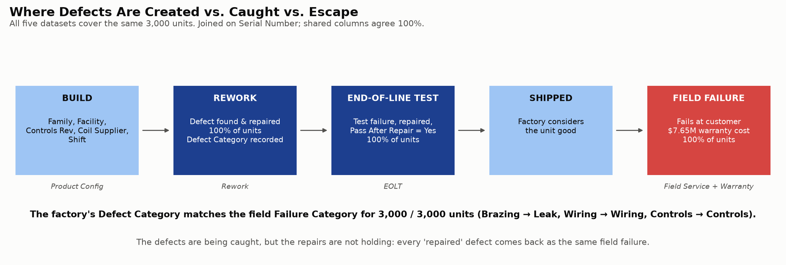
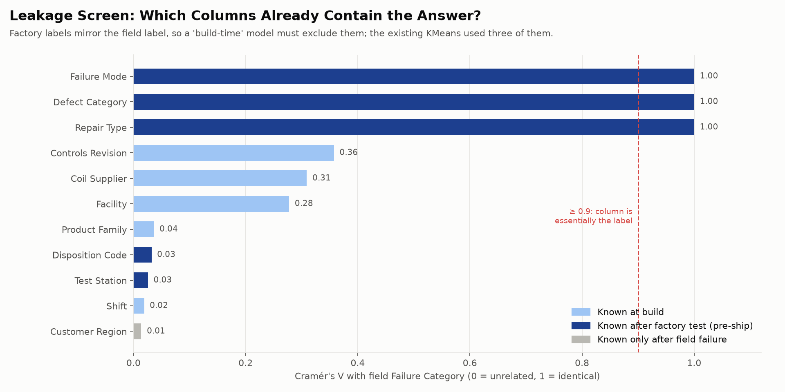

---

## 02 Statistical inference: `02_inference.py`

**Question.** Are the patterns the portfolio relies on statistically real, how large are they, and which causes are confirmed vs. only suspected?

**Method.** For shares: Fisher exact tests with Wilson 95% CIs. For cost: log-linear regression controlling for failure type. Benjamini-Hochberg correction across all 14 tests. **Framing:** every unit failed, so "leak share" is *the share of failures that are leaks* (failure mix), not a failure rate per unit built.

| # | Claim | Effect (95% CI) | q (BH) | Verdict |
|---|---|---|---|---|
| H1 | Supplier B coils leak | 55.7% of failures vs 13.8% (A+C) | 1e-118 | Supported |
| H2 | Facility 2 creates leaks even on A/C coils | 54.1% vs **0 of 1,570** elsewhere | 2e-205 | Supported |
| H3 | Supplier B leak share differs by plant | 56% / 57% / 53% / 57% | 1.00 | Not supported, so it's supplier-driven |
| H4 | Controls faults are Rev A only | 31.7% vs 0 of 2,106 | 1e-164 | Supported |
| H5 | Backward fans are Night shift only | 15.4% vs 0 of 1,801 | 5e-78 | Supported |
| H6 | **NEW:** backward fans only after a "Fan Rotation Correction" rework | 50.5% vs 0 of 2,634 | 3e-191 | Supported |
| H7 | LegacyX costs more for the *same* failure | ×1.52 (1.46–1.58) | 2e-98 | Supported |
| H8 | "Use As Is" costs more than "Rework Completed" | ×1.003 (0.97–1.03) | 1.00 | Not supported |
| H9 | Region / test station / days-to-failure matter | | ≥ 0.72 | Not supported |
| H10 | Loose terminals cluster by facility / supplier / family | max 1.3 pp deviation | | Essentially spread evenly |

**Two independent leak mechanisms.** Supplier B coils leak at every plant (H1, H3), and Facility 2 makes leaks with every supplier (H2). Supplier A/C coils outside Facility 2: 0 leaks in 1,570 failures, 95% upper bound 0.19%.

**Confirmed vs. suspected.** These are statistically certain associations, but an association is not a confirmed physical cause. Each test lists the check that would confirm it before money is spent (`A02_root_cause_tests.csv`, column *Verification*):
- **Supplier B:** helium leak test on an incoming lot of B vs. A/C coils.
- **Facility 2:** braze process audit (alloy, flux, temperature, operator certifications).
- **Rev A:** bench test of Rev A vs. B/C boards.
- **Fan correction (H6):** pull about 20 corrected units and check fan direction. This one is a *suspected* cause: the correction step itself may be reversing fans.

**Non-catalog quick wins the data points to:** a Facility 2 braze audit (A/C-coil leaks at F2 cost **$2.13M/yr**), and a review of the Night-shift fan-correction work instruction (**$0.14M/yr**). Neither needs catalog money.

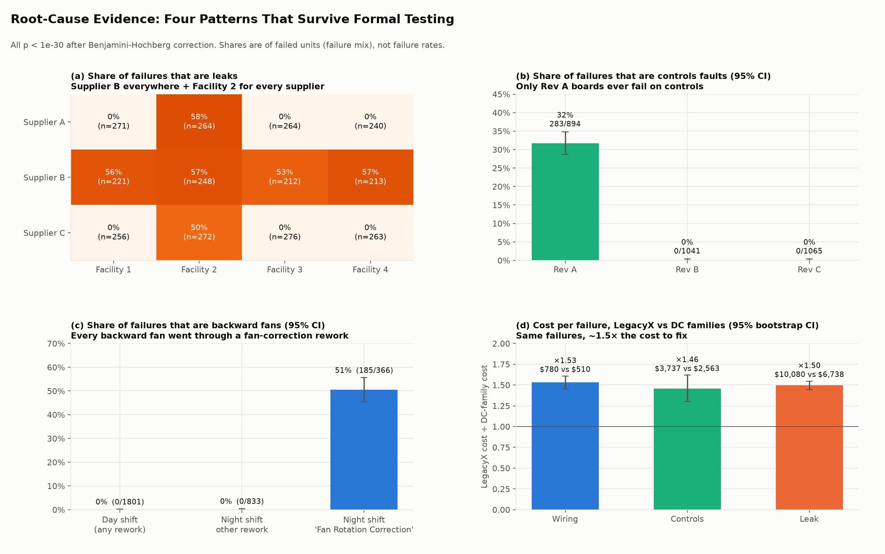

---

## 03 Classification: `03_classification.py`

**Question.** If a unit fails, *which* failure will it be, using only what's known at build time?
**Target:** Failure Category (3 classes). **Unit:** one unit. **Features:** the 5 build columns.
**Validation:** a stratified 20% hold-out (600 units) that is touched once at the end, with 5-fold stratified CV on the other 2,400 for tuning and model choice. Random splits are appropriate here: each unit appears once, there are no repeated measures, and the organizers said dates are informational only (Q&A #1).

| Model (test set) | Log loss ↓ | Macro F1 ↑ | Leak AUC ↑ |
|---|---|---|---|
| Majority class | 12.86 | 0.26 | 0.50 |
| Class prior (base rates) | 0.857 | 0.26 | 0.50 |
| Decision stump (1 split) | 0.787 | 0.44 | 0.70 |
| Logistic regression | 0.565 | 0.51 | 0.84 |
| **Decision tree, depth 3 (chosen on CV log loss)** | **0.485** | 0.49 | 0.84 |
| Random forest | 0.496 | 0.57 | 0.85 |
| Gradient boosting | 0.488 | 0.55 | 0.85 |
| *Ceiling: true cell rates (in-sample)* | *0.443* | *0.64* | *0.90* |

- The tree captures **90% of the achievable improvement** over the base-rate baseline: (0.857 − 0.485) / (0.857 − 0.443).
- **Why accuracy can't go much higher:** builds don't determine failures. Even among Supplier B builds only 56% fail by leaking, so the remaining randomness is irreducible. "Controls" is never the single most likely class (at most 32%, on Rev A), so it never wins an argmax. The probabilities are still useful.
- **Feature importance** (drop in AUC when a feature is shuffled): Controls Revision 0.17, Coil Supplier 0.13, Facility 0.11, Shift 0, Family 0. The tree rediscovers the same three root causes as script 02 (`A03_tree_rules.txt`).
- **Chronological robustness check:** training on the earliest 80% of warranty claims and testing on the latest 20% gives log loss 0.492 and leak AUC 0.85, the same as the random split (`A03_chronological_check.csv`).
- **Calibration:** on the test set, predicted probabilities sit near the diagonal of the reliability plot. Brier scores are 32% (Wiring), 37% (Leak) and 34% (Controls) better than predicting the base rate, so the probabilities can be used to price risk, not just to rank units.
- **Shipment-time comparison:** adding the factory columns gives 100% accuracy, which is evidence for the 01 finding, not modelling skill.

**Decision impact.** If Airedale sends extra leak testing to the builds the model ranks riskiest, the top 30% hold 62% of leak warranty cost (random: 30%). The model's own rule, **"Facility 2 OR Supplier B", flags 48% of builds and catches 100% of leak cost.** That is the scope PortfolioSim uses for Leak Detection, so the targeting is now model-validated on held-out data.

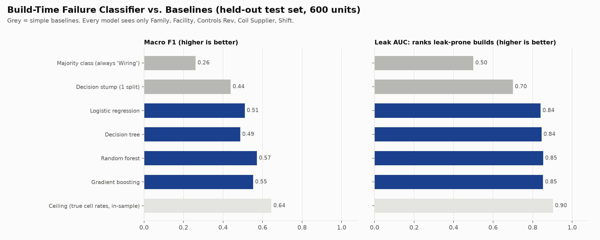
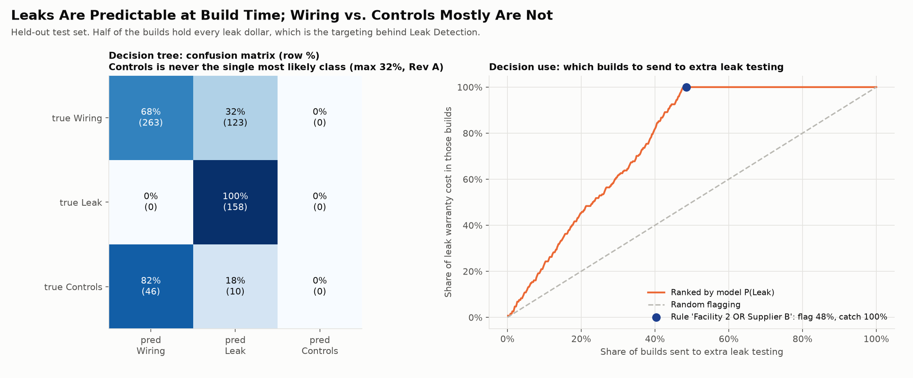
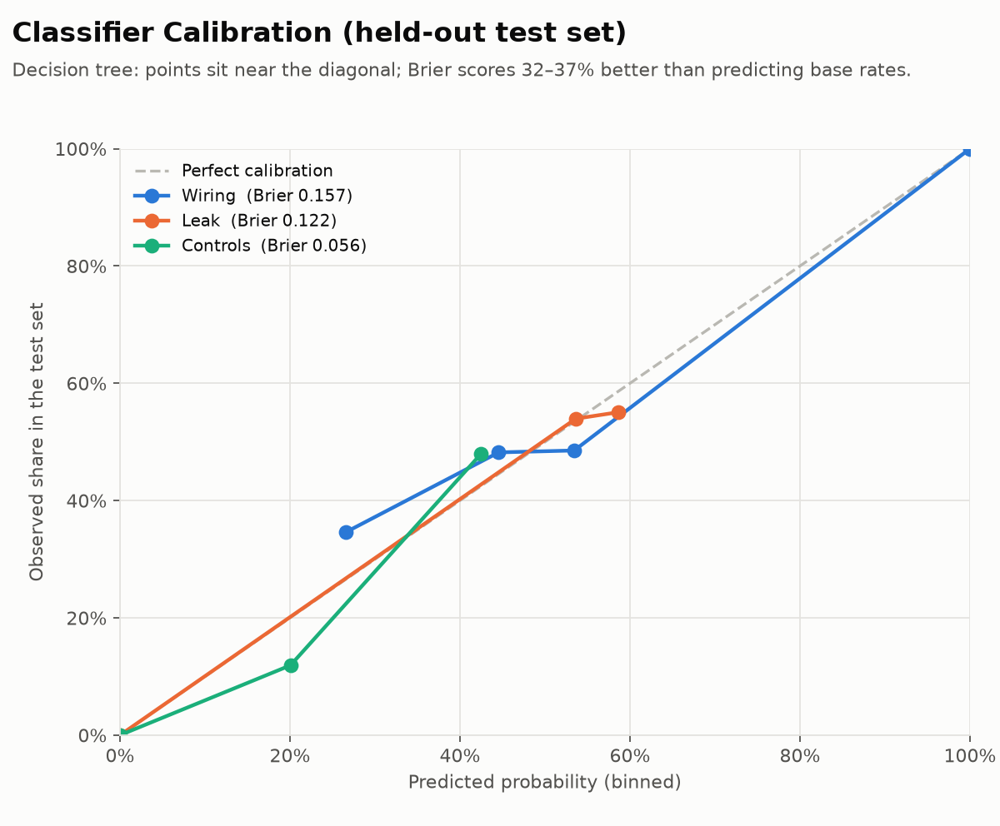

---

## 04 Cost model and kNN re-check: `04_cost_model.py`

### A. Unit-level warranty cost from build data (same 600-unit test set)

| Model | MAE | R² | Total bias |
|---|---|---|---|
| Overall mean (baseline) | $2,588 | 0.00 | +0.3% |
| Product Family mean (baseline) | $2,626 | −0.01 | +0.8% |
| Linear regression | $1,926 | 0.26 | +2.8% |
| Gradient boosting | $1,838 | 0.29 | +2.0% |
| **Two-stage: P(category) × category cost × LegacyX multiplier** | $1,856 | **0.29** | +1.9% |
| *Gradient boosting + factory columns (shipment time)* | *$536* | *0.93* | |

The two-stage model is as accurate as gradient boosting and fully explainable: *chance of each failure type × what that failure costs on this product family.*

**Where it matters for the portfolio:** total cost in each program's target slice, predicted from build data alone. Error vs. actual on the test set:

| Slice | Two-stage error | Family-mean baseline error |
|---|---|---|
| Facility 2 or Supplier B (Leak Detection scope) | +3% | −41% |
| Supplier B coils (Supplier QA scope) | +10% | −39% |
| Controls Rev A (Design Validation scope) | −2% | −19% |
| Night shift (Poka-Yoke fan scope) | −5% | −5% |
| LegacyX units (LegacyX Refresh scope) | +17% (n = 118) | +20% |

This is what lets the model *estimate each problem's cost*, which the catalog asks for, before any warranty claims arrive.

### B. Re-check of `WarrantyCostModel\SupervisedModel.py` (aggregate kNN, reported R² 0.998)

We rebuilt the design faithfully (subsets drawn inside each KMeans cluster, cluster id as a feature) and compared it with simple baselines:

| Design | Features | MAE | R² |
|---|---|---|---|
| Original (same units on both sides of the split) | cluster + build + factory | $51 | 0.998 |
| **Baseline: predict the cluster's average** | cluster id only | $57 | **0.998** |
| **No-ML formula: share of each defect category × its mean cost** | defect shares | **$37** | 0.999 |
| Honest: units split 50/50 *before* subsetting | cluster + build + factory | $72 | 0.997 |
| Honest | build only | $259 | 0.93 |

**What this means.** The R² of 0.998 comes from the *design*, not the model. Subsets are drawn inside one cluster, the clusters are "Wiring vs. not", and so a subset's mean cost is mostly decided before any feature is used. A cluster-average lookup scores the same, and a one-line formula beats kNN. **Recommendation:** don't headline this model in the deck. If it's shown at all, show it with these baselines. Use the unit-level two-stage model instead.

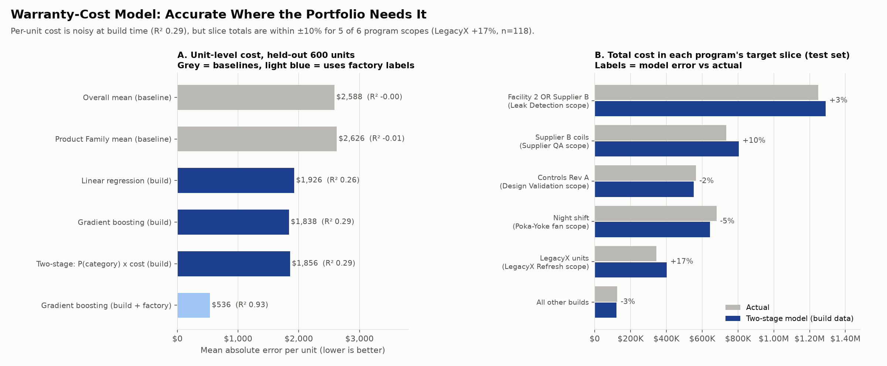
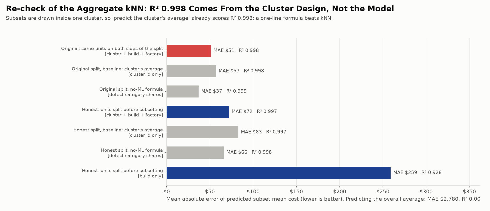

---

## 05 Unsupervised segmentation: `05_segmentation.py`

**Question.** Which build configurations behave alike in the field?
**Unit:** a build cell, Facility × Coil Supplier × Controls Rev × Shift (72 cells, 20–73 units each).
**Features:** each cell's failure mix (shares of loose wiring, backward fan, leak, controls). These are shares, not counts, so cells of different size compare fairly.
**Method:** Ward hierarchical clustering. k is chosen by silhouette, with stability checked by a 200× bootstrap.

**Results**
- **k = 4, silhouette 0.70.** Control check: KMeans on the build features alone scores only 0.12–0.18 for every k. Builds have no natural groups until you look at how they fail.
- **Stable:** median bootstrap ARI 0.91.

| Segment | Builds | Units | Cost / failure | Share of cost | Failure mix | Programs that act here |
|---|---|---|---|---|---|---|
| S1 | Facility 2 **or** Supplier B | 1,430 | $4,417 | **83%** | 55% leak | Leak Detection, Supplier QA, Braze |
| S2 | Rev A, clean coils | 480 | $1,515 | 10% | 44% controls | Design Validation, Poka-Yoke |
| S3 | Rev B/C, Night, clean coils | 442 | $639 | 4% | 24% backward fan | Poka-Yoke, fan-correction fix |
| S4 | Rev B/C, Day, clean coils | 648 | $506 | 4% | 100% loose wiring | Smart Torque |

**What this means.** Without being told the root causes, the clustering finds them, and it shows where the money is: half the builds hold 83% of warranty cost. S4 is the baseline "healthy" process; its only failure is loose terminals, which occur everywhere at the same rate.

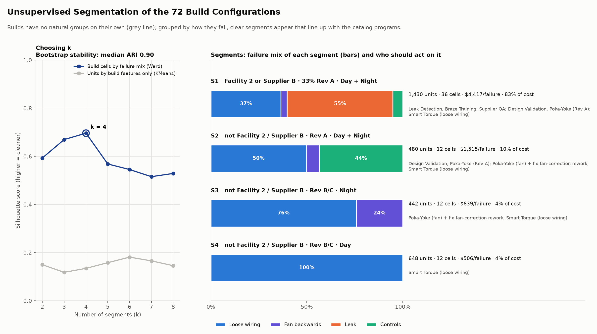

---

## 06 Portfolio extensions: `06_portfolio_extensions.py`

Closes "Next steps" 1–3 in `PortfolioSim\NOTES.md`. It imports PortfolioSim directly; without lag it reproduces their $5,713,203 mean NPV exactly.

1. **Claim lag.** A fix only protects units built after go-live, and they fail 10–240 days later. Savings in month *m* are therefore averaged over the observed days-to-failure distribution: *savings(programs live at m − DTF)*.
2. **Break-even:** the uniform shortfall in all catalog benefits at which 3-year NPV reaches $0.
3. **Tornado:** each program at 50% / 150% of its catalog benefit, or delayed by 3 months.
4. **Re-rank** all 95 within-budget portfolios with lag.

**Recommended portfolio: Braze Training + Wiring Poka-Yoke + Leak Detection + Supplier QA, $700K**

| | PortfolioSim | With claim lag |
|---|---|---|
| Yearly savings once live | $3.38M (44% of $7.65M) | same |
| 3-yr NPV, catalog benefits | $6.44M | **$5.50M** |
| 3-yr NPV, mean of 5,000 runs | $5.71M | **$4.85M** (5th pct $4.01M) |
| ROI (mean NPV / cost) | 8.2× | **6.9×** |
| Payback | month 9 | **month 12** |
| Best portfolio in | 97% of runs | **98% of runs**, still #1 |
| P(NPV < 0) | 0% | 0% |

- **Failures avoided (once all programs are live):** about **595 per year, 19.8% of all failures**. That covers 52% of leaks, 40% of controls faults and 21% of backward fans, worth $3.38M/yr (`A06_failures_avoided_by_type.csv`, `_by_program.csv`). By program, in rollout order: Leak Detection avoids 299 failures ($2.20M), Wiring Poka-Yoke 186 ($0.37M), Supplier QA 71 ($0.52M) and Braze Training 39 ($0.29M). This assumes each catalog % applies to failure counts as well as cost.
- **Break-even:** the portfolio still pays back within 3 years if every program delivers only **10%** of Airedale's catalog estimate.
- **Most sensitive assumption:** Leak Detection's 40% benefit. At 50% of catalog the NPV is $3.94M; at 150% it's $7.05M. A 3-month slip costs at most $0.42M.

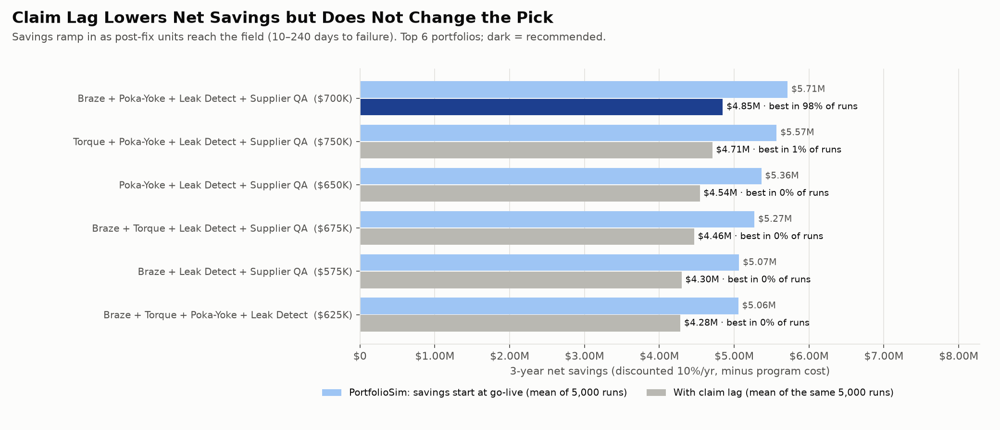
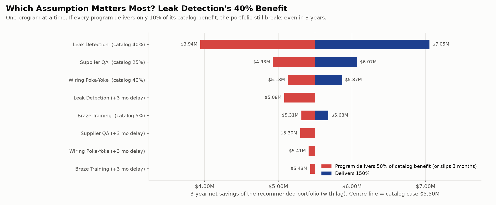
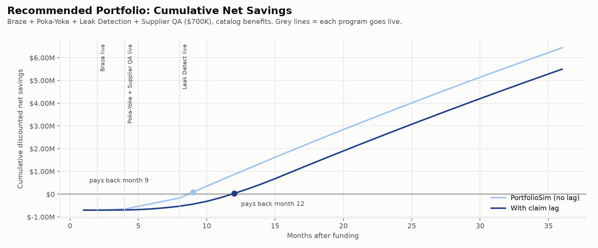

---

## Caveats (say these out loud in the deck)

- **Only failed units are in the data**, so everything is failure *mix* and cost per failure, not failure *rate*. Production volumes by facility, supplier and revision would turn the shares into rates. That's the first data request to Airedale.
- One year of data is treated as a steady annual rate (same as PortfolioSim).
- Associations are not causes. Each root cause has a verification step listed before money is spent.
- The catalog benefits are Airedale's estimates. The Monte Carlo, break-even and tornado show how much the decision depends on them: not much.

## Outputs

| File | What it is |
|---|---|
| `A01_column_lineage.csv` | Every column: source file, tier, distinct values |
| `A01_label_reconciliation.csv` | Factory → field label map with agreement |
| `A01_leakage_screen.csv/.png` | Association of each column with the outcome |
| `A01_existing_cluster_check.csv` | Existing KMeans vs. Wiring label (ARI) |
| `A01_wiring_subtype_trace.csv` | EOLT mode × repair × field failure for Wiring units |
| `A01_defect_journey.png` | Build → rework → EOLT → ship → field diagram |
| `A02_root_cause_tests.csv` | 14 tests: effect, CI, p, q, verdict, verification step |
| `A02_root_cause_evidence.png` | Four-panel evidence chart |
| `A03_*` | Classifier comparison, confusion matrix, tree rules, importance, leak-flagging capture curve |
| `A04_*` | Cost-model comparison, slice calibration, aggregate-kNN re-check |
| `A05_*` | Segments, cell profiles, silhouette by k, bootstrap stability |
| `A06_*` | All 95 portfolios with lag, recommended summary, tornado, cumulative savings |
