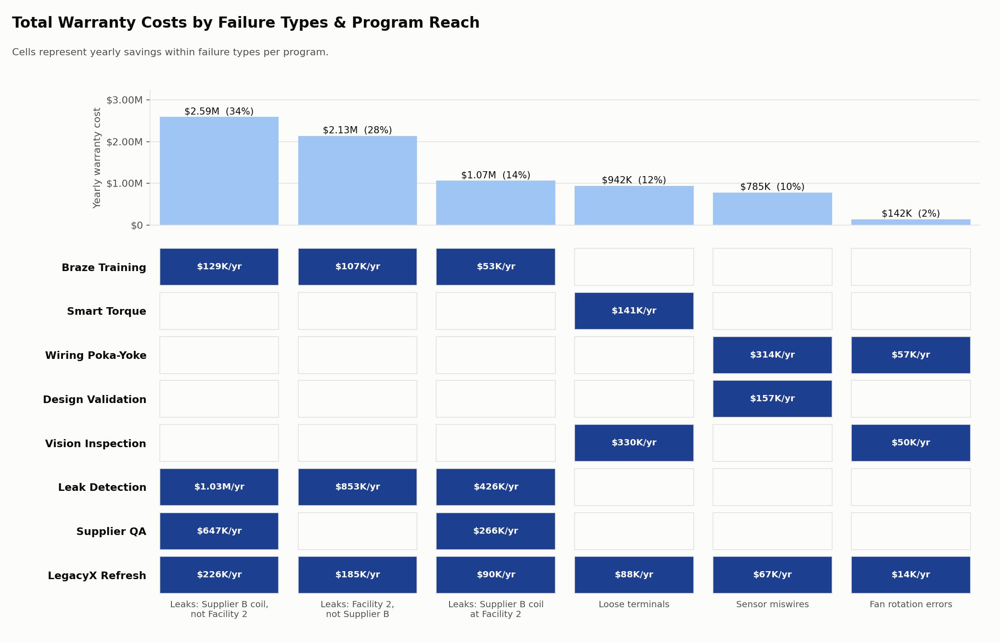
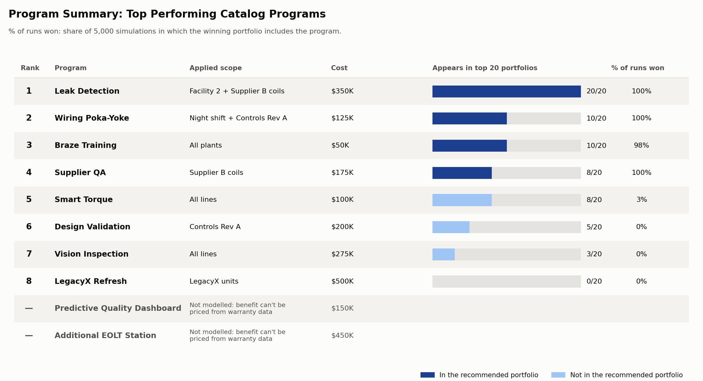
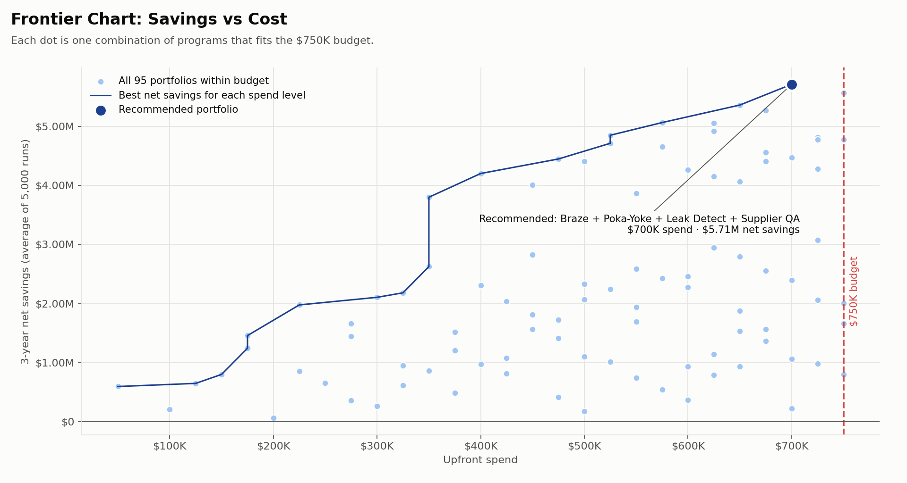
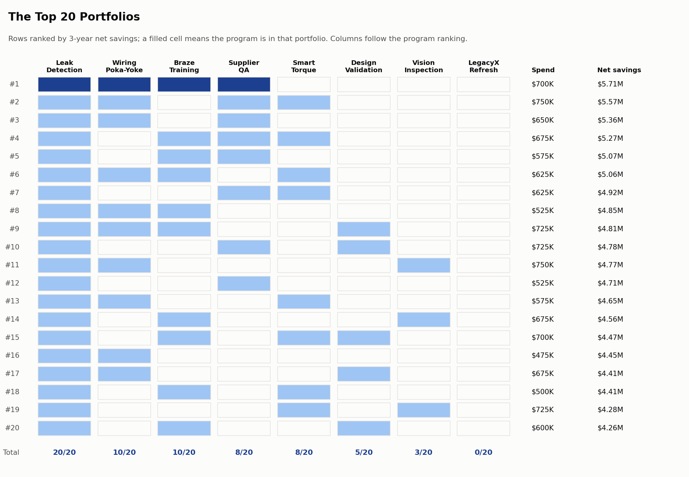
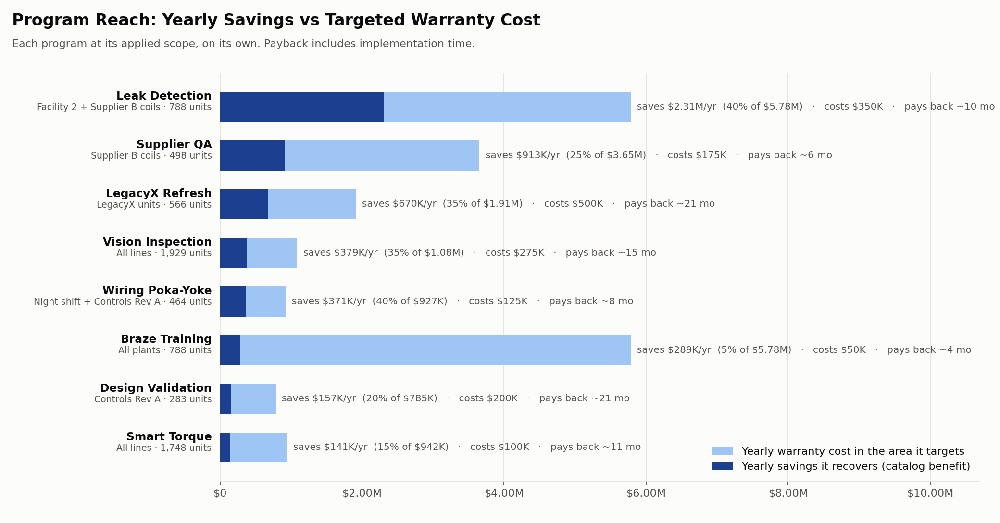
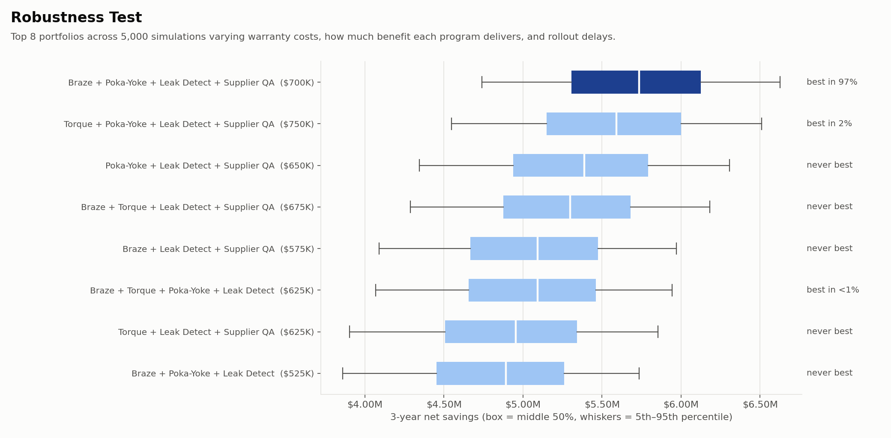

# Portfolio Simulation: Targeted Deployment

Run: `python PortfolioSim\PortfolioSim.py` → everything goes into `outputs\`.

## Approach
- **Net savings** (3-year) = warranty savings over 3 years, minus the upfront program cost.
- Discounted at 10%/yr
- Each program runs only where the data says its problem lives. Compared with running everything everywhere, targeting loses **no** savings, and it shows we are deliberate about where each program goes.
- Despite narrowing scope for some programs, I kept the costs at catalog price because we do not assume a narrower rollout is cheaper.
- Baseline: one year of warranty cost (Data_Full.xlsx) = **$7.65M/yr**, repeated each year for 3 years.
- Spend at month 0; savings switch on after implementation time. 10% discount rate.
- 95 portfolios within $750K.
- Excluded: Predictive Quality Dashboard, Additional EOLT Station (benefit can't be priced from warranty data).

## Robustness test (Monte Carlo, 5,000 runs)
- Warranty costs: resample the 3,000 units each run.
- Benefit delivered: Triangular × catalog benefit. 
  Low risk (0.6, 1.0, 1.2)
  Medium (0.3, 0.9, 1.3) 
  High (0.1, 0.7, 1.3)
- Rollout delay: 0–1 months (Low), 0–3 (Medium), 0–6 (High).

## Total Warranty Cost Analysis

| Slice                                     | $/yr   | Share |
| ----------------------------------------- | ------ | ----- |
| Leaks on Supplier B coils, not Facility 2 | $2.59M | 34%   |
| Leaks at Facility 2, not Supplier B       | $2.13M | 28%   |
| Leaks on Supplier B coils at Facility 2   | $1.07M | 14%   |
| Loose terminals (spread across all lines) | $0.94M | 12%   |
| Sensor miswires (100% Controls Rev A)     | $0.79M | 10%   |
| Fan rotation errors (100% Night shift)    | $0.14M | 2%    |

Note: leaks *only* happen on Supplier B coils or at Facility 2. Supplier A/C coils never leak outside Facility 2.

## Program applications

| Program           | Applied scope                 | Units covered | Cost  | Why                                              |
| ----------------- | ----------------------------- | ------------- | ----- | ------------------------------------------------ |
| Leak Detection    | Facility 2 + Supplier B coils | 48%           | $350K | Every leak is at F2 or on a B coil               |
| Supplier QA       | Supplier B coils              | 30%           | $175K | Only supplier with leaks outside F2              |
| Wiring Poka-Yoke  | Night shift + Controls Rev A  | 58%           | $125K | All fan errors are Night; all miswires are Rev A |
| Design Validation | Controls Rev A                | 30%           | $200K | All controls failures are Rev A                  |
| Braze Training    | All plants                    | 100%          | $50K  | All leaks logged as braze defects                |
| Smart Torque      | All lines                     | 100%          | $100K | Loose terminals are spread across all lines      |
| Vision Inspection | All lines                     | 100%          | $275K | Wiring failures are spread across all lines      |
| LegacyX Refresh   | LegacyX units                 | —             | $500K | LegacyX-only by design                           |

## Results
**Best: Braze Training + Wiring Poka-Yoke + Leak Detection + Supplier QA: $700K**
- Yearly savings once all live: **$3.38M** (44% of warranty cost): $7.65M down to $4.27M/yr.
- **~8.2x ROI**.
- 3-yr net savings: **$6.44M** at catalog benefits; **$5.71M** average over 5,000 runs (5th percentile $4.74M)
- Best portfolio in **97%** of runs; pays back around month 10.
- Runner-up: swap Braze for Smart Torque ($750K, net savings $5.57M, best in 2%).

## Program rankings

| Rank | Program | In top 20 | % of runs won |
|---|---|---|---|
| 1 | Leak Detection | 20/20 | 100% |
| 2 | Wiring Poka-Yoke | 10/20 | 100% |
| 3 | Braze Training | 10/20 | 98% |
| 4 | Supplier QA | 8/20 | 100% |
| 5 | Smart Torque | 8/20 | 3% |
| 6 | Design Validation | 5/20 | 0% |
| 7 | Vision Inspection | 3/20 | 0% |
| 8 | LegacyX Refresh | 0/20 | 0% |
| — | Predictive Quality Dashboard | not modelled | — |
| — | Additional EOLT Station | not modelled | — |

## Notes
- Airedale's estimates; the Monte Carlo sim varies them because we shouldn't assume this is 100% accurate.
- One year of data treated as a steady annual rate; no warranty-claim lag after a fix (avg 125 days to failure), so net savings a bit optimistic.
- Supplier QA applies to all Supplier B leaks, including those at Facility 2 that may keep leaking.
- Data has only failed units, so failure *rates* can't be modelled.

## Next steps
1. Possible lag after implementation to factor in real world lag?
2. No program is facility specific... and facility 2 is an issue, maybe make a mention to this as something to target?
3. Link to our previous supervised cost model somehow?.
4. Turning this into a cohesive narrative for slides.

## Outputs
Tables: `outputs/portfolio_results.csv`, `outputs/program_ranking.csv`, `outputs/program_scopes.csv`.

**Total Warranty Costs by Failure Types & Program Reach** (`fig1_cost_map.png`)

**Program Summary: Top Performing Catalog Programs** (`fig2_program_summary.png`)

**Frontier Chart: Savings vs Cost** (`fig3_portfolio_frontier.png`)

**The Top 20 Portfolios** (`fig4_top20_portfolios.png`)

**Program Reach: yearly savings vs targeted warranty cost, cost and payback per program** (`fig5_program_reach.png`)

**Robustness Test** (`fig6_robustness.png`)

